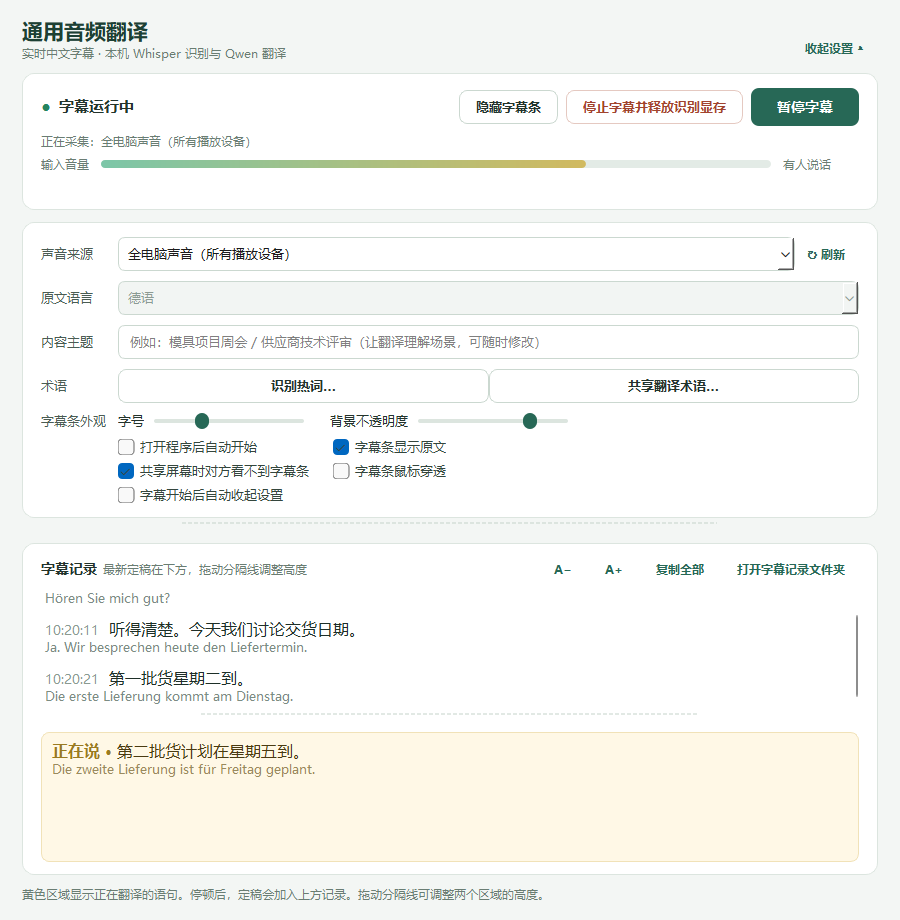

# 音频翻译 · 实时中文字幕

双击 `启动音频翻译.cmd`，播放器、浏览器、会议软件里的德语都会变成屏幕底部的中文字幕。默认监听全电脑播放的声音，语音识别在本机运行，翻译交给同一仓库里的[翻译网关](../gateway/README.md)。原文语言可在控制台改成自动检测、英语、法语、日语或西班牙语。




## 日常使用

1. 双击启动器，或在[通用翻译入口](../text/README.md#日常入口通用翻译windows)里点「打开音频翻译」。单独启动时，字幕会按需启动本机网关。从桌面入口打开时，字幕使用入口已确认的网关地址，再加载 Whisper 和 Qwen。命令行 `--start` 开始或恢复字幕，`--quit` 等待正在运行的字幕程序完成关闭。入口里的「关闭音频翻译」与在这里退出效果相同。加载、运行、暂停和停止状态都会随会话报告给网关。
2. 播放音频。黄色区域逐字显示当前译文，定稿留在上方记录里。拖动两区之间的分隔线可调整高度，拖动悬浮条边缘可调整宽度和行数，Ctrl + 滚轮可调字号。
3. 打开「设置」可切换到单个播放设备、Teams 桌面版、Edge 或 Chrome。系统回环覆盖多个播放设备，较旧的 Windows 会回退到默认播放设备并在控制台提示。「全电脑声音」采集应用的播放输出，麦克风输入需经应用播放才能进入字幕。[Windows 跨设备回环说明](https://learn.microsoft.com/en-us/samples/microsoft/windows-classic-samples/applicationloopbackaudio-sample/)
4. 「暂停」保留识别模型。「停止字幕并释放识别显存」释放 Whisper，文本客户端可以继续通过网关使用 Qwen。没有字幕会话和翻译请求后，网关默认等待 5 分钟再卸载 Qwen。持续 45 分钟无人说话时字幕会自动停止。

字幕条可置顶、鼠标穿透，默认在支持的屏幕共享中隐藏。定稿写入数据目录的 `audio\会议记录\`，包含时间、原文和译文，格式为 Markdown、JSONL。录音不会写入记录。

## 安装与配置

需要 Windows、NVIDIA CUDA、Python 3.12，以及能提供 OpenAI 风格文本推理接口的本地模型。跨设备采集要求 Windows build 20348 或更高。作者的配置为 faster-whisper large-v3-turbo FP16 和 Strata 上的 Qwen3.8-Flash-Next IQ3_S，运行中整卡显存曾达到约 21 GiB。

```powershell
git clone https://github.com/Tim-lanniao/general-translation
cd general-translation\audio
powershell -ExecutionPolicy Bypass -File setup.ps1
New-Item -ItemType Directory -Force ..\data\audio, ..\data\gateway | Out-Null
Copy-Item config.example.json ..\data\audio\config.json
Copy-Item ..\gateway\config.example.json ..\data\gateway\config.json
```

安装脚本准备本目录的 `.venv`、Whisper 权重与 CUDA DLL。已有兼容 DLL 时可用 `-SkipCudaLibs` 并设置 `cuda_dll_dir`。同一个环境也能运行网关，网关只额外需要 filelock。字幕设置保存在数据目录的 `audio\config.json`，翻译模型的设置在 `gateway\config.json`，见[网关配置](../gateway/README.md#配置)。数据目录的位置见[仓库说明](../README.md#数据目录)。[配置示例](config.example.json)

| 配置 | 用途 |
|---|---|
| `source`、`asr_language` | 默认 `system`、`de`，控制台可切换 |
| `asr_model_dir`、`cuda_dll_dir`、`cache_dir` | 识别模型、CUDA 库和缓存的位置；相对的 `asr_model_dir` 以本目录为准 |
| `sample_wav` | 可选的 16 kHz 单声道 WAV，在声音来源中作为回放样例 |
| `topic`、`terms` | 内容主题与识别热词，均可在控制台修改 |

字幕会话由网关持有 `gpu_lock`，所以与其他 GPU 作业互斥的设置也在网关配置里。

## 识别热词与共享翻译术语

在控制台打开「识别热词」可维护本地德语人名、产品和场景。科隆音码帮助匹配近音，支持 `[注塑展]` 分组和 `[]` 通用组。「内容主题」与最近定稿影响选择。每次最多送入 32 个名称，实际 Whisper 分词器计算整条提示，包含空格和标点在内不超过 223 个 token。

「共享翻译术语」由网关保存，字幕和文本翻译共用。控制台的按钮通过网关的 `/admin/terms` 读写，规则见[网关的共享术语](../gateway/README.md#共享术语)。字幕程序会把识别热词中无歧义的近音还原为原名，由网关查找指定译法。术语改动后，正在修订的句子也会重新翻译。

## 字幕延迟与回放

默认在开口约 1.4 秒后首次识别，此后约每 2 秒修订一次。普通临时识别用 beam 1，长句切分和定稿用 beam 5。Silero 首次判定静音时提前处理句尾，重新开口会使旧结果失效。已覆盖最后一帧语音且带有句末标点时，最快静音 384 毫秒确认，其余默认等 600 毫秒。只有完整译文会写入记录。

在本目录运行：

```powershell
.\.venv\Scripts\python.exe -m audio_caption.engine --replay sample.wav --record-dir replay-output
.\.venv\Scripts\python.exe -m unittest discover -s tests
```

## 字幕流水线的历史实测

以下数据来自引入共享网关之前的版本。2026-11-19 在 Windows 11、RTX PRO 4000 Blackwell 24 GB 上，通过同一组 3 段各 60 秒的德语问答录音，对照上一版 `1b49261`。两次都使用预热后的 Whisper Turbo FP16 和 Qwen3.8-Flash-Next IQ3_S，关闭思考，术语表留空。两个版本分别产生 7 和 8 次停顿定稿。时间从 VAD 检测到开口或最后一帧语音算起，终点是引擎向界面发出字幕事件。

| 耗时（秒） | 优化前中位 | 优化后中位 | 优化前 P95 | 优化后 P95 |
|---|---:|---:|---:|---:|
| 开口 → 首个汉字 | 2.39 | 2.20 | 2.47 | 2.79 |
| 开口 → 第一版完整译文 | 2.45 | 2.35 | 2.61 | 2.86 |
| 语音结束 → 停顿定稿 | 1.98 | 1.43 | 2.84 | 2.41 |

8 次停顿中有 7 次用上了提前识别的结果。短暂停顿后继续说话也会触发试算，这次回放的识别调用从 100 增至 172 次。整卡显存采样峰值约 20.6 GiB。缩短断句会改变分段，小样本中首字 P95 有所上升。实际 Teams 通话的端到端延迟仍待实测。

当时参与对照、现已退役的 Hy‑MT2‑7B 单独回放其中 60 秒，停顿定稿中位数从 1.82 秒降至 0.84 秒，旧版 2 次停顿，新版 3 次。两种模型的定稿均保留了 19、80、800、190 公斤四个选项。

词表从 503 条扩到 5,003 条后，同一句展会德语仍只匹配到 3 条，传给翻译的术语文本都是 43 个字符。实际 Whisper 分词器计得识别提示为 216 个 token。用含 504 条术语的配置从正常入口回放 19 秒原声，Qwen 定稿写出了「海参」和「裸鼹鼠」。两种模型在独立的术语句测试中也都采用了这两个译名，产品型号有时仍会按原文输出。

单独测试采集端的重采样，对 10 毫秒音频包重复计时，每组 1,000 包，取 6 组的中位数。48 kHz 转 16 kHz 从每包 50 降到 14 微秒，44.1 kHz 转 16 kHz 从 387 降到 23 微秒。分包输出已逐样本与整段重采样核对。

## 已知限制

- 只在作者的一台电脑上测试过；`setup.ps1` 尚未在全新电脑上完整验证。
- 新版 Teams 的通话声音应由 `ms-teams.exe` 的子进程播放；若进程回环采不到声音，请改选播放设备。
- 当前桌面版使用 Windows 与 NVIDIA CUDA。实时延迟的历史评测使用德语音频。
